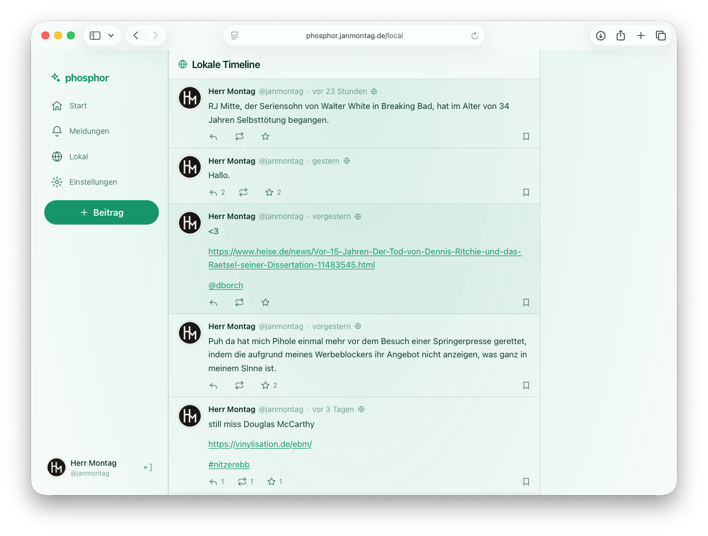

# Phosphor

Ein schlankes, schnelles Web-Frontend für [GoToSocial](https://gotosocial.org) — gebaut mit SvelteKit.

> GoToSocial ist ein API-only Server und bringt keine eigene Weboberfläche mit.
> Phosphor ist ein Mastodon-kompatibler Client, der direkt gegen die API deiner Instanz spricht.



## Status

Frühes MVP. Die GoToSocial-Instanz wird auf der Login-Seite gewählt und lokal
gespeichert; für eigene Installationen lässt sie sich per `VITE_INSTANCE_URL`
vorbelegen (siehe `.env.example`).

## Roadmap

### Erledigt

- [x] OAuth-Login (App-Registrierung → `/oauth/authorize` → `/oauth/token`)
- [x] Instanz-Auswahl beim Login — eine Installation für beliebige GoToSocial-Instanzen
- [x] Start-Timeline und lokale Timeline, inkl. Infinite Scroll
- [x] Live-Streaming über WebSocket (neue Beiträge und Meldungen)
- [x] Beiträge verfassen: Inhaltswarnung, Sichtbarkeit, Anhänge mit ALT-Text
- [x] Schreibmodus: Markdown oder Plaintext (explizit umschaltbar)
- [x] Custom-Emoji-Picker im Composer
- [x] Favorisieren, Boosten, Merken
- [x] Eigene Beiträge bearbeiten und löschen
- [x] Thread-Ansicht mit Kontext und Inline-Antworten
- [x] Antworten mit sichtbarer @-Erwähnung
- [x] Profile: Bio, Felder, Zähler, Beiträge und Folgen/Entfolgen
- [x] Folgenanfragen annehmen und ablehnen
- [x] Blockieren und Stummschalten aus dem Profil
- [x] Originalprofil oder Originalbeitrag öffnen und Link kopieren
- [x] Erwähnungen im Beitragstext intern auf Profile verlinken
- [x] Suche (Personen, Hashtags, Beiträge) und Hashtag-Seiten
- [x] Benachrichtigungen mit Filtern und lokalem Gelesen-Status
- [x] Push-Benachrichtigungen per Web Push — ohne externen Relay, inkl. neuer Beiträge
      gefolgter Accounts (dort je Account über die „Glocke“ aktivierbar)
- [x] Erscheinungsbild: Hell / Dunkel / System
- [x] Barrierefreie Schriftgröße (100 % – 200 %), wirkt auf die ganze App
- [x] Reduzierte Bewegung (Systemeinstellung oder erzwungen)
- [x] Installierbar als App (PWA-Manifest + Icons) für den Home-Bildschirm

### Als Nächstes

- [ ] Bilder-Lightbox und Video-Handling statt „neuer Tab“
- [ ] Offline-Cache (der Service Worker existiert bereits für Push, cached aber bewusst nichts)
- [ ] Barrierefreiheit ausbauen und mit Screenreadern testen
- [ ] i18n: UI-Strings aus den Komponenten in Sprachdateien ziehen
- [ ] Link-Preview-Cards — blockiert: GtS 0.22 liefert `card` nie (kein OpenGraph-Fetch);
      die Anzeige in `StatusBody` ist fertig, bräuchte aber Server-/Proxy-Unterstützung

## Stack

- **SvelteKit 3 / Svelte 5** (Runes) als reines SPA über `adapter-static`
- **TypeScript**
- **Tailwind CSS v4**
- Eigener, dünner API-Client (`fetch` + `WebSocket`) — keine Client-Bibliothek nötig

## Entwicklung

Voraussetzungen: Node ≥ 22.12 (siehe `.nvmrc`) und pnpm.

```bash
pnpm install
pnpm dev
```

Dann <http://localhost:5173> öffnen, die Adresse der eigenen GoToSocial-Instanz
eingeben und auf „Anmelden“ klicken. Die App registriert sich dabei pro Origin
selbst als OAuth-App.

Für eine Instanz-spezifische Installation (eine Domain, ein Server) lässt sich
die Instanz vorausfüllen:

```bash
cp .env.example .env
# VITE_INSTANCE_URL=https://social.example.org
pnpm build
```

Die Login-Seite bleibt änderbar; ohne Vorgabe startet sie leer.

### Scripts

| Befehl          | Zweck                                    |
| --------------- | ---------------------------------------- |
| `pnpm dev`      | Dev-Server                               |
| `pnpm build`    | Production-Build nach `build/`           |
| `pnpm preview`  | Build lokal ausliefern                   |
| `pnpm check`    | Typecheck (svelte-check)                 |
| `pnpm test`     | Unit-Tests (Vitest)                      |
| `pnpm test:e2e` | Browser-Tests (Playwright, gemockte API) |
| `pnpm lint`     | Prettier + ESLint                        |
| `pnpm format`   | Code formatieren                         |

Wie man die App vollständig testet (live, lokal, automatisiert) steht in
[`TESTING.md`](TESTING.md).

## Deployment

`pnpm build` erzeugt eine rein statische SPA in `build/`, die auf jedem Static-Host
(nginx, Caddy, Netlify, Cloudflare Pages, …) liegt — solange unbekannte Pfade auf
`index.html` zurückfallen (SPA-Fallback).

Produktiv läuft Phosphor auf einem Raspberry Pi hinter Caddy unter
<https://phosphor.janmontag.de>. Deployen mit:

```bash
./scripts/deploy.sh
```

Details, Caddy-Block und Fehlersuche: [`docs/DEPLOY.md`](docs/DEPLOY.md).

Die `redirect_uri` beim Login ist `window.location.origin + /callback`. Der Browser muss also
nach der Autorisierung zu dieser Origin zurückfinden.

## Barrierefreiheit

- **Farbschema:** Hell, Dunkel oder System (folgt `prefers-color-scheme`). Umschaltbar unter
  _Einstellungen_; die Wahl wird gespeichert und vor dem ersten Rendern angewendet.
- **Schriftgröße:** 100 % – 200 % in sechs Stufen. Es skaliert **nur die Typografie** —
  Layout-Breiten, Abstände und Bilder bleiben fest im Rahmen, es wirkt also wie „Große
  Schrift“ und nicht wie Zoom. Icons und Avatare folgen über dieselbe Variable
  (`--ui-scale`), damit sie nicht winzig wirken. Für echtes Seiten-Zoom bleibt zusätzlich der
  Browser-Zoom verfügbar.
- **Bewegung:** Respektiert `prefers-reduced-motion` des Systems; in den Einstellungen lässt
  sich „reduziert“ zusätzlich erzwingen. Animationen werden dann auf nahezu null Dauer gesetzt,
  nicht entfernt — Zustandswechsel bleiben sichtbar.

## GoToSocial-Besonderheiten

- GoToSocial spricht **nur WebSocket-Streaming**, kein SSE.
- Die Standard-Sichtbarkeit neuer Beiträge ist häufig _nicht gelistet_.
- GoToSocial backfillt keine alten Beiträge — Timelines wirken anfangs leer.
- Rate-Limits (HTTP 429) und Throttling (503) kommen regelmäßig vor; der Client wiederholt
  idempotente Requests mit Backoff.
- **Push bei neuen Beiträgen** verschickt GoToSocial nur an Follower, die für den Account die
  Benachrichtigungen aktiviert haben (die „Glocke" bzw. das `notify`-Flag am Follow) — nicht an
  alle gefolgten Accounts. Boosts und Antworten lösen keinen `status`-Push aus.
- **Web Push** verlangt den Scope `push` im Token und auf iOS 16.4+ die zum Home-Bildschirm
  hinzugefügte PWA. Fehlt der Scope, lehnt der Server das Abo mit **403** ab; die App bietet
  dann „Neu einloggen" an und registriert das vorhandene Abo danach automatisch nach.

Mehr Details in [`docs/ARCHITECTURE.md`](docs/ARCHITECTURE.md) und
[`docs/DEPLOY.md`](docs/DEPLOY.md).

## Lizenz

MIT — siehe [`LICENSE`](./LICENSE).
